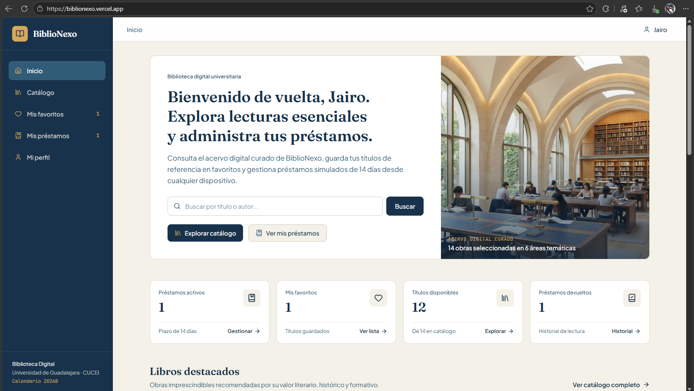
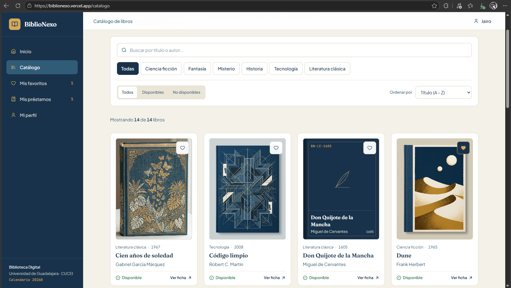
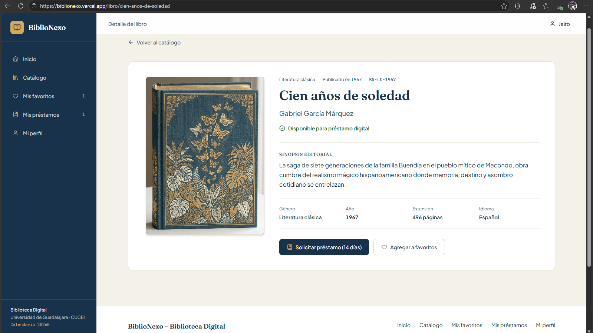

# BiblioNexo — Biblioteca Digital

BiblioNexo es una aplicación web que simula una biblioteca digital, permitiendo explorar un catálogo de libros, consultar información detallada, guardar favoritos y administrar préstamos de manera sencilla desde una interfaz moderna y adaptable.

## Objetivo

Desarrollar una plataforma web intuitiva que facilite la organización y consulta de una colección digital de libros, ofreciendo herramientas para gestionar favoritos, préstamos y datos del perfil del usuario.

## Funcionalidades

- **Panel principal:** resumen de la actividad del usuario y acceso a las secciones principales.
- **Catálogo:** exploración, búsqueda y filtrado de libros.
- **Detalle del libro:** consulta de información individual de cada ejemplar.
- **Favoritos:** guardar y quitar libros de una lista personal.
- **Préstamos:** solicitar préstamos simulados y registrar devoluciones.
- **Perfil:** consultar y editar la información del usuario.
- **Persistencia local:** conservar los datos mediante LocalStorage del navegador.
- **Diseño adaptable:** interfaz preparada para utilizarse en computadoras y dispositivos móviles.

## Tecnologías utilizadas

- React
- TypeScript
- Vite
- Tailwind CSS
- React Router DOM
- Lucide React
- LocalStorage
- Git y GitHub

## Herramientas de inteligencia artificial

Durante el desarrollo se utilizaron herramientas de inteligencia artificial como apoyo:

- **Google AI Studio:** generación inicial de la aplicación y su estructura.
- **ChatGPT:** apoyo en la elaboración de instrucciones, revisión de configuraciones, resolución de problemas y documentación.

La aplicación no requiere una API de inteligencia artificial para funcionar.

## Estructura del proyecto

```text
biblionexo/
├── public/
├── src/
│   ├── assets/
│   │   └── images/
│   ├── components/
│   ├── context/
│   ├── data/
│   ├── pages/
│   ├── services/
│   ├── types/
│   └── utils/
├── index.html
├── package.json
├── package-lock.json
├── tsconfig.json
└── vite.config.ts
```

## Instalación y ejecución

### Requisitos previos

- Node.js
- npm
- Git (opcional, para clonar el repositorio)

### 1. Clonar el repositorio

```bash
git clone https://github.com/Jairo-MJ/biblionexo.git
```

### 2. Entrar al directorio

```bash
cd biblionexo
```

### 3. Instalar dependencias

```bash
npm install
```

### 4. Ejecutar en modo desarrollo

```bash
npm run dev
```

Vite mostrará en la terminal la dirección local para abrir la aplicación en el navegador.

### 5. Generar la versión de producción

```bash
npm run build
```

### 6. Comprobar los tipos de TypeScript

```bash
npm run lint
```

## Integrante

**Jairo José María Morales Jiménez**

Proyecto individual — Desarrollo de Aplicaciones Web en la Nube y Móviles.

**Docente:** Zeus Emmanuel Gutiérrez Cobián  
**Calendario:** 2026B

## Consideraciones

BiblioNexo es un prototipo académico. Los préstamos y devoluciones son simulados y la información se conserva localmente en el navegador mediante LocalStorage.

Actualmente no cuenta con un servidor, base de datos remota, autenticación real ni conexión con un sistema bibliotecario externo.

## Capturas de pantalla

## Capturas de pantalla

### Pantalla de inicio


### Catálogo de libros


### Detalle de un libro


## Enlaces

- **Repositorio GitHub:** https://github.com/Jairo-MJ/biblionexo
- **Aplicación desplegada:** https://biblionexo.vercel.app/

## Conclusión

BiblioNexo integra diferentes herramientas del desarrollo web moderno para construir una experiencia de biblioteca digital funcional. El proyecto permitió aplicar conocimientos de componentes, navegación, gestión de estado, almacenamiento local, diseño adaptable, control de versiones y herramientas de inteligencia artificial durante el proceso de desarrollo.